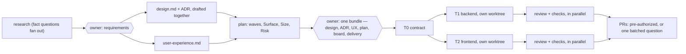
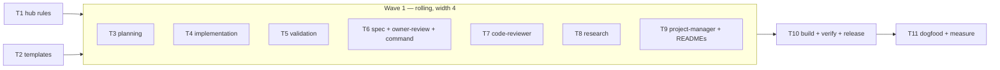

# Workflow improvement plan — small units, parallel by default

> **Status:** Approved by the owner on 2026-10-16, with the §9 defaults. Written on `refactor/workflow-execution-scope` (0.12.0).
> **Scope:** the four-pillar flow (`workflow-research`, `workflow-planning`, `workflow-implementation`,
> `workflow-validation`), `workflow-spec`, the `spec` command, `code-reviewer`, `project-manager`, and the
> hub [Delivery Flow — Four Pillars](../knowledge-base/fluxo-de-entrega-quatro-pilares.md).
> **Goal:** less wall-clock time between Tasks, through parallel work, short reviews and less repeated work,
> without dropping a single safety rule.

---

## 1. What "faster" means here, and what stays untouched

Time between Tasks is lost in four ways. Each finding in §3 belongs to one of them:

| Kind | Where the time goes |
| --- | --- |
| **serial** | independent work waits for unrelated work to finish |
| **waiting** | the flow stops for the owner more often than the decision requires |
| **duplication** | a later pillar re-derives what an earlier one already decided |
| **long review** | a review reads more diff, or reads it more times, than the change needs |

**What does not change.** The changes below reorder, batch and scope the work. They remove no gate:

- no pillar moves forward with an open decision (`WF-CORE-03`);
- the author never approves their own change, and review stays in fresh context (`WF-VAL-01`);
- a status moves only on the owner's explicit answer, and silence approves nothing (`WF-SPEC-06`);
- every pillar runs in a named agent on its own tier (`WF-CORE-06`), and the orchestrator keeps only envelopes (`WF-CORE-07`).

---

## 2. The critical path today

Worked case: a product-scope increment with one backend Task, one frontend Task and one ADR. This is
the example the skills already use (checkout discount approval). The diagram follows the written
procedure step by step.

| Counted from the procedure text | Today |
| --- | --- |
| owner stops | **8** |
| agent hops on the critical path | **~16** |
| Tasks running at the same time | **1** |
| full reviews of a Task that needed one fix round | **2** |

These are counts read from the procedure, not measured times. Wall-clock time is measured in §7
(`WF-VAL-05`).

---

## 3. Findings

### 3.1 Serial

| ID | Finding | Where |
| --- | --- | --- |
| S1 | Implementation is defined as "one Task at a time". Planning hands off only "the first unit". The "Order" section of the plan says independent Tasks *can* run in parallel, but no step tells anyone to run them that way | [hub:118](../knowledge-base/fluxo-de-entrega-quatro-pilares.md#L118), [hub:135](../knowledge-base/fluxo-de-entrega-quatro-pilares.md#L135), [planning:204](../skills/workflow/workflow-planning/SKILL.md#L204), [spec:87](../commands/spec.md#L87), [template-tasks:47](../skills/workflow/workflow-spec/references/template-tasks.md#L47) |
| S2 | Planning drafts and reviews documents one at a time. The ADR starts only after `design.md` is `Accepted`. `user-experience.md` does not depend on `design.md`, yet it waits in the same line | [spec:63](../commands/spec.md#L63), [planning:88](../skills/workflow/workflow-planning/SKILL.md#L88), [workflow-spec:152](../skills/workflow/workflow-spec/SKILL.md#L152) |
| S3 | The plan is written only after every design file is approved (Step 2 runs before Step 5), and the whole plan must be `Ready` before any Task starts. So a backend Task waits on a UX approval it never cites | [template-tasks:28](../skills/workflow/workflow-spec/references/template-tasks.md#L28), [planning:154](../skills/workflow/workflow-planning/SKILL.md#L154) |
| S4 | Inside validation, review (Step 1) comes before the checks (Step 3), though `code-reviewer` and `repo-operator` read different inputs and do not depend on each other | [validation:67](../skills/workflow/workflow-validation/SKILL.md#L67), [validation:96](../skills/workflow/workflow-validation/SKILL.md#L96) |
| S5 | A Task in the plan has no **Surface** (the files it touches). Without one, nobody can show that two Tasks are disjoint, so running them in sequence is the only safe choice. The field exists only on board items | [template-tasks:52](../skills/workflow/workflow-spec/references/template-tasks.md#L52) vs [template-task:47](../skills/workflow/workflow-spec/references/template-task.md#L47) |
| S6 | Parallel sessions are covered only for model tier. Nothing covers isolation (same directory or worktree), fan-in, or what to do when one parallel Task breaks another | [planning:216](../skills/workflow/workflow-planning/SKILL.md#L216), [hub:186](../knowledge-base/fluxo-de-entrega-quatro-pilares.md#L186) |

### 3.2 Waiting

| ID | Finding | Where |
| --- | --- | --- |
| W1 | Each file is reviewed in its own owner message, then the flow stops: five or more stops for one product increment | [workflow-spec:148](../skills/workflow/workflow-spec/SKILL.md#L148), [owner-review](../skills/workflow/workflow-spec/references/owner-review.md) |
| W2 | Push/PR needs the owner's go-ahead per Task, so N Tasks mean N stops | [validation:153](../skills/workflow/workflow-validation/SKILL.md#L153) |
| W3 | Publishing to the board is its own stop, after the plan is `Ready`, though it could be asked in the same message as the plan | [planning:195](../skills/workflow/workflow-planning/SKILL.md#L195) |

### 3.3 Duplication

| ID | Finding | Where |
| --- | --- | --- |
| D1 | The implementer runs the full seven-category edge sweep again on each Task. The plan already carries the edges research answered, as acceptance lines | [implementation:107](../skills/workflow/workflow-implementation/SKILL.md#L107) vs [research:130](../skills/workflow/workflow-research/SKILL.md#L130), [portoes](../skills/workflow/workflow-planning/references/portoes.md) |
| D2 | Readiness is derived three times: planning Step 1, the four gates, and implementation Step 1 | [planning:65](../skills/workflow/workflow-planning/SKILL.md#L65), [implementation:67](../skills/workflow/workflow-implementation/SKILL.md#L67) |
| D3 | The evidence decision is made twice: planning names the test types (`WF-PLAN-06`), then validation runs the §4.4 risk tree again | [planning:121](../skills/workflow/workflow-planning/SKILL.md#L121), [validation:76](../skills/workflow/workflow-validation/SKILL.md#L76) |
| D4 | The same `WF-CORE-06/07` self-check rows appear in five skills, and the `spec` command restates the skills' checklists | [research:163](../skills/workflow/workflow-research/SKILL.md#L163), [planning:173](../skills/workflow/workflow-planning/SKILL.md#L173), [implementation:168](../skills/workflow/workflow-implementation/SKILL.md#L168), [validation:133](../skills/workflow/workflow-validation/SKILL.md#L133), [workflow-spec:176](../skills/workflow/workflow-spec/SKILL.md#L176), [spec:91](../commands/spec.md#L91) |
| D5 | `code-reviewer` "demands evidence: the test output". It has `executar` and may run the checks `repo-operator` already ran | [code-reviewer:121](../agents/code-reviewer.md#L121) |

### 3.4 Long review

| ID | Finding | Where |
| --- | --- | --- |
| L1 | A Task has no size budget. `WF-PLAN-03` blocks splitting without a criterion, but nothing forces a big Task to split, so the size of a review has no upper limit. Small batches are already house doctrine | [hub:507](../knowledge-base/fluxo-de-entrega-quatro-pilares.md#L507), [trunk-based-development:35](../knowledge-base/trunk-based-development.md#L35) |
| L2 | After a fix, the whole unit is "reviewed again", not just the open findings and the fix diff | [validation:152](../skills/workflow/workflow-validation/SKILL.md#L152) |
| L3 | The reviewer gets no Surface to compare against. Scope creep (`WF-IMPL-03`) is found by reading the whole diff when a file-list comparison would catch it | [revisao-em-contexto-independente](../skills/workflow/workflow-validation/references/revisao-em-contexto-independente.md) |

---

## 4. Target model

### 4.1 Five principles

1. **The Task is the unit of parallelism, and it is small.** One owner, one Surface, one PR, inside a
   review budget (§4.4).
2. **Contract first.** A contract shared by two Tasks lands first, as its own small Task: types or
   schema only, with the shape test the plan already requires
   ([planning:142](../skills/workflow/workflow-planning/SKILL.md#L142)). After that, producer and
   consumer run at the same time.
3. **Waves, executed on a rolling basis.** The plan groups Tasks into waves by dependency. When it
   runs, a Task starts as soon as its dependencies close and a slot is free. It does not wait for the
   whole wave.
4. **Batch the owner.** One review message per stage, not per file. Delivery authorization is asked
   once, together with the plan.
5. **Decide once, carry forward.** Edges, readiness and risk class are fields on the Task. Later
   pillars check what changed since; they do not derive it again.

### 4.2 Target flow, same worked case

| Counted from the procedure text | Today | Target |
| --- | --- | --- |
| owner stops | 8 | **2–3** (requirements, planning bundle, and one batched PR question if delivery was not pre-authorized) |
| Tasks running at the same time | 1 | up to the wave width (§4.3) |
| full reviews of a Task with one fix round | 2 | **1**, plus one delta re-review |

### 4.3 Who runs in parallel, and where

| Work | How it runs | Isolation | Why |
| --- | --- | --- | --- |
| research fact gathering | N bounded `repo-explorer` questions at once | same directory, read-only | homogeneous agents share the cached prefix ([CC-PAR §4.3](../knowledge-base/claude-code-paralelismo-e-escala.md#L169)); each question stays bounded (`CC-PAR-04`) |
| `design.md` + ADR ‖ `user-experience.md` | two owner agents at once, both starting from `requirements.md` | same directory, different files | neither reads the other's file |
| plan | drafted right after those drafts exist, citing them as `Draft` | — | the owner reviews them together (§4.6) |
| writing Tasks in one wave | one owner subagent per Task | **own worktree and branch per Task**; the PR follows `Delivery` (one per Task by default) | concurrent commits in one checkout clash, and `CC-PAR-02` |
| validation of one Task | `code-reviewer` ‖ `repo-operator` checks ‖ `devops-security` when `Risk: security` | same worktree as the Task, read-only | the three read different inputs |
| validation of Tn ‖ implementation of Tn+1 | pipelined | — | review time leaves the critical path |

Worktrees do not share the prompt cache ([CC-PAR §3](../knowledge-base/claude-code-paralelismo-e-escala.md#L142)).
So the rule is: a worktree for **writing**, the same directory for **reading**. That spends extra
tokens only where file conflicts are real.

**When a Task may join a running wave.** All five must hold:

1. every Task in its `Depends on` closed in validation;
2. its inputs are accepted (`WF-SPEC-04`);
3. no open gap it depends on (`WF-CORE-09`);
4. its Surface is disjoint from every running Task's Surface, or they overlap only on a contract an
   earlier Task already landed;
5. a slot is free. The **wave width** defaults to **4** writing Tasks (owner decision, §9). Above that,
   validation falls behind and the orchestrator holds too many envelopes.

**Fan-in.** Every Task "ships alone safely" (already a field), so each PR merges on its own. After a
merge, worktrees still open rebase onto the new base. Baseline gates run once on the merged trunk, not
once per Task. When a merged change breaks a running Task, the orchestrator messages that Task's
session ([CC-PAR §6.2](../knowledge-base/claude-code-paralelismo-e-escala.md#L245)) and it handles the
break like a fix round.

### 4.4 Small Tasks: the review budget

Each Task declares **Surface** (files) and **Size** (estimated changed lines, tests included). It must
fit the project's review budget. The suggested default is **≤ 300 changed lines, ≤ 2 review families,
1 owner**. That default is a † decision, to be confirmed by the owner and then calibrated with measured
data (§7).

Above the budget, the Task is re-sliced, in this order of preference:

1. **by acceptance scenario.** Each slice keeps its own acceptance, evidence and dependency, so
   `WF-PLAN-03` still holds;
2. **by expand → migrate → contract step.** Add the new shape, move the callers, remove the old one;
   each step ships alone;
3. **never by layer or by file.** That would be splitting for the writer's convenience, which
   `WF-PLAN-03` forbids.

If an implementer finds the Task will exceed its Size by more than half, it returns to planning: row 2
of [condicoes-de-parada](../skills/workflow/workflow-implementation/references/condicoes-de-parada.md).

### 4.5 Short reviews

| Change | Effect |
| --- | --- |
| The reviewer receives the Task's diff, acceptance, Surface, `Risk` and the check envelope, and nothing else | it reads only what it judges; still fresh context (`WF-VAL-01`) |
| Step 0: `git diff --name-only` must be ⊆ Surface; any file outside it is a finding (`WF-IMPL-03`) | scope creep is caught in seconds, before reading code |
| The reviewer does not re-run checks; it reads `repo-operator`'s envelope | removes D5 |
| **Delta re-review**: after a fix, a new reviewer instance gets the open findings and the diff since the last reviewed commit. It closes or keeps each finding, and raises a new one only where the fix introduced it | a second review costs a fraction of the first. A full re-review happens only if the fix diff leaves the Surface or touches a contract |
| The check types the plan named still run in full on every round | the delta applies to reading, not to proof |

### 4.6 Fewer owner stops

- **Planning bundle.** One message lists every `Draft` of the stage: `design.md`, ADRs,
  `user-experience.md`, the plan, the board items. Each file gets its own path, sentence and gaps, plus
  how the files depend on each other. The owner answers per file, or "approve all" naming them.
  `WF-SPEC-06` still holds: the answer is explicit and names the files. A "change" on an upstream file
  re-drafts only the files that depend on it.
- **Delivery authorization with the plan.** The plan gets a `Delivery` field: `pr-per-task` (the
  default) or `pr-per-wave`, plus whether the owner authorizes push and PR for this plan's Tasks once
  each is clean. The owner's words are quoted in the plan, and the authorization covers this plan only.
  Merging always stays with the owner. Without the authorization, the flow asks one batched question
  per wave: "T1 and T3 are clean — push and open their PRs?".
- **Board publish** is asked in the planning bundle, not after it.

### 4.7 Decide once, carry forward

| New field on each Task | Set by | Read by | Removes |
| --- | --- | --- | --- |
| `Surface` | `project-manager`, from the owners' estimates | the wave scheduler, the reviewer's Step 0 | S5, L3 |
| `Size` | same | the decomposition gate | L1 |
| `Wave` + `Depends on` | same | the orchestrator | S1 |
| `Risk`: `contract` · `security` · `focused` (the §4.4 tree, applied at plan time) | same, with `software-architect` for contracts | validation, which re-runs the tree only if the diff leaves the Surface | D3 |
| `Edges answered`: links to the acceptance lines | same | the implementer, who sweeps only what the code reveals (a **delta sweep**) | D1 |
| no new field: **Inputs** (by link, with each file's status) plus **Depends on** already say when the Task is ready | same | implementation Step 1, which only re-reads those status lines | D2 |

Shared self-check: the `WF-CORE-06/07/09` rows move to one "core self-check" block in hub §7. Each
skill then keeps one row ("core self-check passed") plus its own pillar's rows. The `spec` command
cites the skills' self-checks instead of repeating them (D4).

---

## 5. Rule changes

All new rules are † (decisions of this project). The IDs below act as the **contract** for §6: every
Task cites them before the hub text is final, which is what lets Wave 1 run in parallel.

| ID | Change | Rule, in short |
| --- | --- | --- |
| `WF-CORE-10` | new | Tasks whose dependencies are closed, inputs accepted, Surfaces disjoint and gaps closed **MUST** start together, up to the wave width; running them one at a time with no stated reason **NEVER**. Parallel writing **MUST** use one worktree per Task; parallel reading **MUST** share the directory |
| `WF-PLAN-07` | new | Each Task **MUST** declare Surface and Size and fit the project's review budget; above it, re-slice by acceptance scenario or by expand/migrate/contract step, **NEVER** by layer or file |
| `WF-PLAN-08` | new | A contract shared by Tasks that would run in parallel **MUST** land first as its own Task, with the shape test in its first consumer |
| `WF-PLAN-06` | amend | the evidence plan also records each Task's `Risk` class (§4.4 tree, at plan time) |
| `WF-IMPL-06` | amend | the question list starts from the Task's `Edges answered` and adds only what the code reveals (delta sweep) |
| `WF-VAL-06` | new | a re-review after a fix **MUST** be scoped to the open findings and the fix diff, in a new independent instance; a full re-review only when the fix diff leaves the Surface or touches a contract |
| `WF-SPEC-04` | amend | a Task starts when the plan is `Ready` **and** its own inputs are accepted. The plan may be `Ready` while another Task's input is still `Draft` |
| `WF-SPEC-06` | amend | one owner answer may approve several files when it names them (bundle review); silence still approves nothing |
| hub §3 | edit | "one Task at a time" becomes "one Task per implementer instance; independent Tasks run as a wave" |
| hub §6 Count | edit | 38 → 42 rules |

---

## 6. Execution plan — this improvement, as small Tasks in waves

Owner of every writing Task: `ai-engineer` (it "creates this project's skills and agents"). Mechanical
Tasks go to `repo-operator`. No Task runs the build: `dist/claude-code/` is rewritten wholesale, so it is
a **shared Surface** and gets one Task of its own, last. That is the parallel-safe rule (§4.3, item 4)
applied to this plan.

| Task | Wave | Surface | Size | Depends on | Acceptance | Test types |
| --- | --- | --- | --- | --- | --- | --- |
| **T1** · write the §5 rules into the hub | 0 | `knowledge-base/fluxo-de-entrega-quatro-pilares.md`, and `knowledge-base/MANIFESTO.md` regenerated by `indexar.sh` (it hashes every note) | ~140 | none (IDs fixed in §5) | every §5 row exists in hub §6 with its wording; §3 lines 118/135 edited; §4.2 gains the wave rule and the review budget; §7 gains the core self-check block; Count reads 42 | static: `bash build/verificar.sh`, `bash build/indexar.sh --verificar` |
| **T2** · add the new Task fields to the templates | 0 | `workflow-spec/references/template-tasks.md`, `template-task.md` | ~60 | none | template-tasks gains `Wave`, `Surface`, `Size`, `Risk`, `Edges answered`, and a plan-level `Delivery`; **Order** becomes a wave table; line 28 reads per-Task readiness | static: `verificar.sh`; a grep that every new field appears in both templates |
| **T3** · parallel drafting and wave handoff in planning | 1 | `workflow-planning/SKILL.md`, `references/portoes.md` | ~90 | T1, T2 | Step 2 drafts design+ADR ‖ UX; Step 4 sets `Risk`; Step 5 writes waves, Surface, Size; the decomposition gate checks the budget and contract-first; Step 7 hands off a wave and asks for the bundle and delivery in one message; self-check uses the core row | static; a grep finds no "first unit" or "one at a time" left |
| **T4** · wave execution and delta sweep in implementation | 1 | `workflow-implementation/SKILL.md`, `references/condicoes-de-parada.md` | ~50 | T1, T2 | Step 1 re-reads only the `Ready when` status lines; the unit runs in its own worktree; Step 3 is the delta sweep; a Size overrun of more than half returns to planning | static |
| **T5** · concurrent validation and delta re-review | 1 | `workflow-validation/SKILL.md`, `references/revisao-em-contexto-independente.md`, `references/proporcionalidade-da-evidencia.md` | ~70 | T1, T2 | review ‖ checks ‖ security start together; `Risk` is read, and the tree re-runs only off-Surface; delta re-review (`WF-VAL-06`); push/PR uses `Delivery` or one batched question per wave | static |
| **T6** · bundle review in spec writing | 1 | `workflow-spec/SKILL.md`, `references/owner-review.md`, `references/project-document-set.md`, `commands/spec.md` | ~70 | T1, T2 | Step 4 supports the bundle message; owner-review documents multi-file answers; the project's record can hold its review budget and wave width (hub §4.2); the `spec` command's Phase 2 drafts in parallel and reviews once; its checklist cites the skills | static |
| **T7** · reviewer input contract and Step 0 | 1 | `agents/code-reviewer.md` | ~35 | T1 | input = diff + acceptance + Surface + `Risk` + check envelope; Step 0 Surface check; no re-run of checks; a delta mode section | static |
| **T8** · fan out research fact questions | 1 | `workflow-research/SKILL.md` | ~15 | T1 | Step 2 sends independent bounded questions to `repo-explorer` at once; self-check uses the core row | static |
| **T9** · plan writing and docs | 1 | `agents/project-manager.md`, `skills/workflow/README.md`, `agents/README.md` | ~40 | T1, T2 | the PM's plan-writing paragraph covers waves, Surface, Size, Risk; the README rule count and handoff text match the hub | static |
| **T10** · build, verify, release | 2 | `dist/claude-code/**`, `.claude-plugin/`, `README.md` version | mechanical | T1–T9 | `verificar.sh`, `indexar.sh --verificar` and `claude-code.sh` exit 0; version bumped | `repo-operator` runs the three commands and reports their exit codes |
| **T11** · dogfood on one real increment and measure | 3 | a consumer project | — | T10 | §7 metrics recorded before and after on comparable increments | manual, with date, environment and result |

**Progress (2026-10-16):** T1 and T2 are done and validated. `verificar.sh` and `indexar.sh --verificar`
exit 0. An independent `code-reviewer` returned three findings, all fixed. The fix then got a delta
re-review (`WF-VAL-06`), which approved it. Each Task is one commit on this branch, not pushed.
T3–T9 are ready to start.

Critical path: T1 → (the longest of T3–T9) → T10. At width 4, T7, T8 and T9 start as T3–T6 close.
Each Task is one commit and fits the budget it introduces.

---

## 7. How we will know it worked

Measured, not perceived (`WF-VAL-05`). The envelope gains two optional keys, `inicio` and `fim` (ISO
timestamps, keeping the envelope's schema language). Together with commit times, they give:

| Metric | Baseline | Target |
| --- | --- | --- |
| owner stops per increment | 8 (§2 worked case) | ≤ 3 |
| lead time per Task, plan `Ready` → validated | measure in T11 | down, with no target until the baseline exists |
| idle time: a ready Task waiting for a slot or a gate | measure | down |
| Tasks inside the review budget | measure | ≥ 80% |
| reviewer tokens on a delta re-review ÷ first review | measure | < 30% |
| Tasks that ran next to at least one other Task | 0% | share of independent Tasks |
| **guardrail:** findings that escape review, change failure rate | measure | **must not rise** |

---

## 8. Risks and trade-offs

| Risk | Mitigation |
| --- | --- |
| a plan drafted from `Draft` design files needs rework when the owner changes the design | the bundle shows dependencies; a "change" re-drafts only dependents; the alternative is an owner choice (§9.5) |
| parallel worktrees cost more tokens than serial work (no shared cache) | worktrees only for writing; research, review and checks share the directory; the wave width caps it |
| merge conflicts between parallel PRs | disjoint Surfaces, contract first, rebase after each merge, cross-session message on a break |
| more, smaller PRs mean more merges for the owner | `Delivery: pr-per-wave` (one PR per wave, one commit per Task, reviewed per commit) |
| a delta re-review misses a regression outside the fix diff | full re-review when the fix leaves the Surface or touches a contract; the named checks still run in full every round |
| pre-authorized push happens without a fresh look | opt-in, scoped to one plan, the owner's words quoted; merging always stays with the owner |
| the orchestrator's context grows with N envelopes | ≤ 30 lines per envelope (`WF-CORE-07`); a closed Task keeps only its `resultado` line |

---

## 9. Owner decisions

Answered on 2026-10-16, in the owner's words: *"Approve the plan with its suggested defaults (300-line
budget, 4 Tasks at once, a PR per Task, push/PR approved with the plan, plan drafted alongside design).
Start with T1 and T2."*

| # | Question | Decision |
| --- | --- | --- |
| 1 | review budget default | ≤ 300 changed lines, ≤ 2 review families, 1 owner |
| 2 | wave width default | 4 writing Tasks at once |
| 3 | default delivery | `pr-per-task` |
| 4 | pre-authorizing push/PR in the plan | allowed, as an opt-in the owner gives with the plan |
| 5 | plan timing | drafted alongside the design drafts, reviewed in one bundle |
| 6 | where this lives | not answered; until it is, the plan runs from this file and §6 tracks progress |

These are workflow defaults. They do not authorize any push or PR of this repository's own branch.
